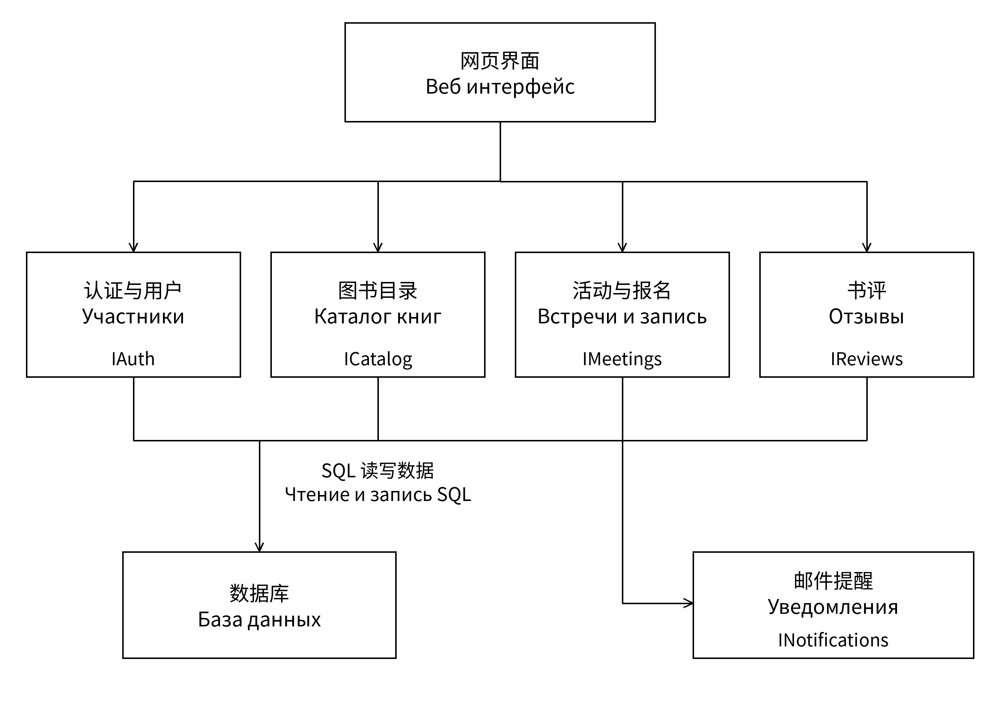
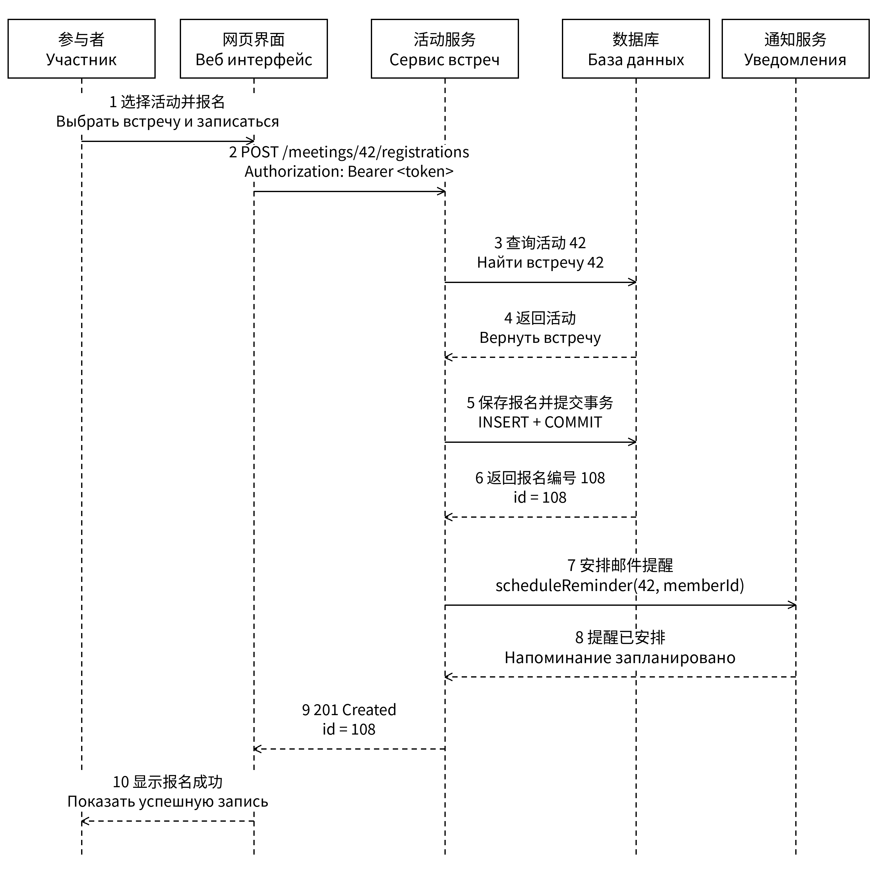

# 架构与报名流程 / Архитектура и запись

采用模块化单体和共享关系数据库。组件包括网页界面、认证与用户、图书目录、活动与报名、书评、邮件提醒。
Используются модульный монолит и общая реляционная база. Компоненты: интерфейс, аутентификация, каталог, встречи и запись, отзывы, уведомления.

## 组件图 / Компоненты

## 报名顺序 / Порядок записи

正常流程是验证身份、检查活动、保存报名、提交事务、安排提醒并返回 201。重复报名返回 409，活动不存在返回 404，不产生重复提醒。
Нормальный сценарий: проверить пользователя и встречу, сохранить запись, зафиксировать транзакцию, запланировать письмо и вернуть 201. Дубли дают 409, отсутствующая встреча — 404; повторное напоминание не создаётся.

[需求 / Требования](requirements.md) · [接口 / API](../api/bookclub.openapi.yaml) · [返回目录 / Содержание](../README.md)
